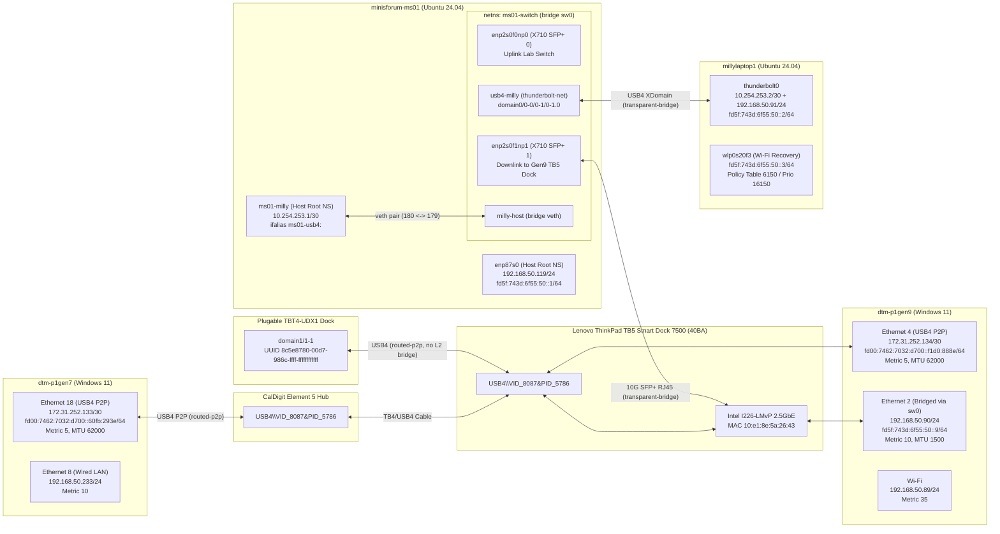

# Unified USB4/Thunderbolt Multi-Hub, SFP+ Switch Namespace & `10.*` Fabric Control-Plane Design (`DOC-036` Alignment)

**Document ID**: `PC-AI-DESIGN-USB4-SFP-VNV`  
**Related `vigil_ai` Traceability Artifact**: `DOC-036` (`Fleet Control-Plane & Multi-Hub USB4/SFP+ Fabric Architecture`, pending TPM admission)  
**Related `vigil-spark` PRs**: `#2804` (`docs/network/fleet-control-plane-proposal.md`), `#2805` (`ms01-network-switch` namespace custody)  
**Target Crate**: `C:\codedev\PC_AI\Native\pcai_core\pcai_tb_cli` (`pcai-tb`)  
**Target Registry**: `C:\codedev\PC_AI\Config\thunderbolt-peers.json`

---

## 1. Architectural Consensus & Trade-Off Analysis (`codex-ms01`, `claude-asus-fleetnet`, `gemini`)

### 1.1 Key Design Decisions & Consensus Answers (Thread: `fleet-unification`)

1. **Decision 1 — Site ULA `/48` vs P2P ULA & IPv4 Ranges**:
   - **Pros/Cons of Single Site `/48` (`fd5f:743d:6f55::/48`) vs Dual Prefix**:
     - `claude-asus-fleetnet` correctly observed that `fd5f:743d:6f55::/48` is an RFC 4193 random `/48` prefix, whereas `fd00:7462:7032::/48` used ASCII `"tbp2"`.
     - **Consensus**: We support carving subnet IDs under `fd5f:743d:6f55::/48` (e.g., `fd5f:743d:6f55:0050::/64` for the bridged `192.168.50.0/24` LAN/SFP+/USB4-bridge canary plane and `fd5f:743d:6f55:d700::/64` for routed P2P links) while retaining backwards-compatible support in `pcai-tb` for `fd00:7462:7032::/48` until all Slice C gates cut over.
     - For IPv4 routed P2P links: deterministic `/30` subnets from `172.31.240.0/20` (where `gen7 <-> gen9` is `172.31.252.132/30`, which is subnet index `801` inside `172.31.240.0/20`). Explicit registry overrides (`10.254.253.0/30` on `minisforum <-> millylaptop1`) take precedence when declared.
2. **Decision 2 — Pending TPM Intake Gate Mapping (`PENDING-FABRIC-F09..F13`)**:
   - Until `DOC-036` / `TR-FABRIC-F09..F13` are formally admitted into `vigil_ai`'s TPM/requirements registry, every slice criterion uses `PENDING-FABRIC-F09..F13` with `tpm_admission_status: "PENDING_TPM_INTAKE"` and `acceptance_credit: false` in both code (`// trace: PENDING-FABRIC-F09 [implements]` / `[verifies]`) and live `pcai-tb vnv` JSON output (`vigil.hil-device-evidence/v1`).
3. **Decision 3 — Fail-Closed Verdict Enum & Sentinel vs Registry Authority**:
   - `pcai-tb vnv` enforces a closed 5-state verdict enum (`PASS`, `FAIL`, `SKIP_NOT_APPLICABLE`, `BLOCKED_MISSING_PROVIDER`, `HOLD_PENDING_TPM_INTAKE`) and never emits vacuous `PASS` when a provider is `None` or a route is missing.
   - `pcai-tb` separates its own Linux USB4 observation (`PcaiLinuxUsb4Observation`, `schema: "pcai.linux-usb4-observation/v1"`) from the authoritative MS01 helper receipt (`VigilMs01Usb4CheckReceipt`, `schema: "vigil.ms01-usb4-check/v1"`), which is populated exclusively by running `/usr/local/sbin/ms01-usb4-extension check` and verifying its contract (`ready`, `phase == "running"`, `boot`, `owner`, `parent_owner`, `peer_uuid`, `interface`, `control_veth`, `namespace`, `bridge`).
   - Registry declarations (`sfpSwitchTopologies` and `topologyLinks` in `thunderbolt-peers.json`), **not** mutable sentinel files on disk, determine whether a switch port or USB4 bridge extension is expected. Missing `/var/lib/ms01-network-switch/current.json` or `/var/lib/ms01-network-switch/usb4-milly/current.json` on a declared switch host fails closed (`overall_status: "FAIL"`, exit code `1`).
4. **Decision 4 — Programmatic L2 Broadcast Loop Prevention (`PENDING-FABRIC-F09`)**:
   - Any parallel physical path between two hosts (such as `minisforum <-> dtm-p1gen9` via 10GbE SFP+ `enp2s0f1np1` -> `Lenovo TB5 Smart Dock 7500` `Ethernet 2` AND via `Plugable TBT4-UDX1` USB4 hub `domain1/1-1`) **must not** both be enslaved to `sw0` as `transparent-bridge` without explicit cycle admission checks.
   - `detect_l2_bridge_cycles` in `src/identity.rs` validates non-empty endpoints and uses Disjoint-Set Union (Union-Find) per `bridgeDomain` (`ms01-switch/sw0`), rejecting any registry configuration that creates an L2 cycle across `transparent-bridge` links.

---

## 2. Multi-Hub Physical & Logical Topology (`dtm-p1gen7`, `dtm-p1gen9`, `minisforum-ms01`, `millylaptop1`)

---

## 3. Traceability & Verification Matrix (`vigil_ai` Pending TPM Intake Alignment)

| Candidate Gate ID | Target Requirement ID | Admission Status | Verification Method | Implementation Reference | Test Reference |
|---|---|---|---|---|---|
| `PENDING-FABRIC-F09` | `REQ-SPARK-001` | `PENDING_TPM_INTAKE` (`acceptance_credit: false`) | Unit Test + Live Read-Only V&V | `detect_l2_bridge_cycles` (`src/identity.rs`), `collect_local_usb4_router_tree` (`src/switch.rs`) | `test_validate_peer_registry_rejects_l2_bridge_cycles_and_overlapping_shared_subnets` |
| `PENDING-FABRIC-F10` | `REQ-SPARK-002` | `PENDING_TPM_INTAKE` (`acceptance_credit: false`) | Unit Test + Negative Controls | `evaluate_linux_switch_custody_from_json`, `evaluate_linux_usb4_extension_custody_from_json`, `parse_and_validate_ms01_usb4_check_receipt` (`src/switch.rs`) | `test_evaluate_linux_switch_and_usb4_extension_custody_from_json_and_negative_controls`, `test_ms01_usb4_check_receipt_validation_and_vnv_pending_intake_gates` |
| `PENDING-FABRIC-F11` | `REQ-SPARK-003` | `PENDING_TPM_INTAKE` (`acceptance_credit: false`) | Unit Test + CLI Test | `validate_peer_registry` (`src/identity.rs`), `inspect_linux_canary_endpoints`, `inspect_windows_canary_endpoints` (`src/switch.rs`) | `test_validate_peer_registry_ipam_and_sfp_topology_invariants`, `test_route_and_ipv6_exact_matching_rejects_partial_or_wrong_gateway` |
| `PENDING-FABRIC-F12` | `REQ-COMPUTE-001` | `PENDING_TPM_INTAKE` (`acceptance_credit: false`) | Unit Test + Live Read-Only V&V | `evaluate_windows_metric_hierarchy` (`src/switch.rs`), `plan_and_apply_adapter_actions_with_rollback` (`src/configure.rs`) | `test_evaluate_windows_metric_hierarchy_detects_wifi_wired_conflict_and_empty_or_missing_metric` |
| `PENDING-FABRIC-F13` | `REQ-MOB-001` | `PENDING_TPM_INTAKE` (`acceptance_credit: false`) | Unit Test + CLI Test | `inspect_and_apply_shared_subnet_routes`, `windows_route_print_has_exact_route`, `linux_ip_route_json_has_exact_route` (`src/switch.rs`) | `test_windows_route_output_succeeded_rejects_false_positive_exit_zero`, `cli_vnv_subcommand_emits_vigil_hil_device_evidence` |

Related implementation acceptance: [route query verification](../usb4-route-verification.md).
